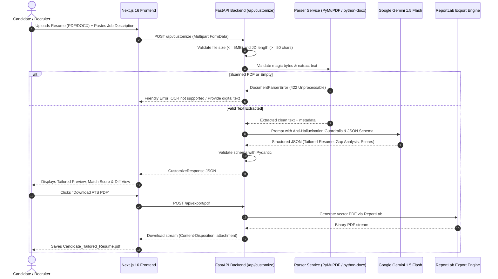

# ResumeCraft AI — Production-Grade AI Resume Customizer

> **Full-Stack Developer Hiring Assignment for ThePrepLab / Innovista Labs**  
> An intelligent, ATS-optimized resume customization web application built with **Next.js 16 (App Router)**, **FastAPI (Python)**, and **Google Gemini AI**, engineered with **100% factual integrity and strict anti-hallucination guardrails**.

---

## 🌟 Live Demo & Preview

- **Frontend Deployment (Vercel):** `https://resumecraft-ai.vercel.app` *(or custom Vercel domain)*
- **Backend API Deployment (Render):** `https://resumecraft-ai-backend.onrender.com`
- **Interactive Swagger Docs:** `https://resumecraft-ai-backend.onrender.com/docs`
- **Backend Health Check:** `https://resumecraft-ai-backend.onrender.com/health`

---

## 🚀 Key Features

### 1. Document Extraction & Resilient Parsing
- **Dual Format Support:** Native parsing of **PDF** (`.pdf`) and **Microsoft Word** (`.docx`).
- **File Validation:** Magic byte signature inspection (`%PDF-` and `PK\x03\x04`), extension check, and strict 5MB upload size enforcement.
- **Scanned / Image-Only PDF Detection:** Accurately flags non-selectable image scans and encrypted documents, returning friendly recovery instructions instead of silent failures.
- **Table & Multi-Page Extraction:** Robust extraction of complex resume layout tables via `python-docx` and multi-page stream parsing via `PyMuPDF`.

### 2. Intelligent AI Customization (Google Gemini 1.5 Flash)
- **Role Alignment:** Matches resume experience and skills with the target Job Description (JD).
- **Summary Rewrite:** Crafts a targeted 3-4 sentence professional summary aligned with role requirements.
- **Google X-Y-Z Bullet Point Optimization:** Rephrases experience bullets into high-impact accomplishment statements (*"Accomplished [X] as measured by [Y] by doing [Z]"*).
- **Strict Anti-Hallucination Guardrails:**
  - ❌ Never invents degrees, employers, job titles, dates, or metrics.
  - ❌ Never turns an unverified target skill into a claimed candidate skill.
  - ✅ Missing keywords and unsupported requirements are isolated strictly in the gap analysis.

### 3. Transparent Heuristic Match Score & Keyword Analysis (Bonus)
- **Explainable Match Score:** 0–100% composite score broken down into:
  - **Keyword Match Score (40%):** Direct terminology coverage.
  - **Core Skills Alignment (30%):** Categorized technical competence match.
  - **Experience Fit (30%):** Relevance of roles and responsibilities.
- **Keyword Gap Analysis:**
  - 🟢 **Matched Keywords:** Verified in source resume and emphasized in tailored version.
  - 🟡 **Missing Keywords:** Required by JD but unevidenced in candidate resume.
  - 💡 **Actionable Recommendations:** Ethical guidance to bridge qualification gaps.

### 4. Interactive Review & Before-and-After Diff (Bonus)
- **Side-by-Side Comparison:** Interactive diff view comparing original resume summary and bullets with tailored versions.
- **One-Click Demo Loader:** Instant sample full-stack resume and job description loader to evaluate the entire pipeline with a single click.

### 5. Multi-Format ATS Export (PDF & DOCX)
- **Crisp ATS-Friendly PDF:** High-resolution ReportLab generation with standard margins (0.5"), selectable text, clean typographic hierarchy, and no overlapping glyphs.
- **Editable Word Export:** Formatted Microsoft Word document (`.docx`) matching the tailored content.
- **Tailored Cover Letter Generator (Bonus):** Optional matching 3-paragraph formal cover letter downloadable as PDF or ready to copy.

---

## 🛠️ Technology Stack

| Layer | Technology | Rationale |
|---|---|---|
| **Frontend Framework** | **Next.js 16 (App Router)** | Server Components, Turbopack, high performance, and rapid prerendering. |
| **Language & Typing** | **TypeScript** | Strict compile-time safety across request/response contracts. |
| **Styling** | **Tailwind CSS v4** | Modern responsive design, sleek dark theme, glassmorphism, and print stylesheet. |
| **Icons & Feedback** | **Lucide React + Canvas Confetti** | Accessible icons and delightful micro-interactions. |
| **Backend Framework** | **Python 3.11 / 3.13 + FastAPI** | High-throughput asynchronous API with automatic OpenAPI documentation. |
| **Schema Validation** | **Pydantic v2 & Pydantic-Settings** | Strict data validation, environment variable binding, and schema sanitization. |
| **Document Parsing** | **PyMuPDF (`fitz`) + python-docx** | Fast C-backed PDF text extraction and robust DOCX XML table/paragraph extraction. |
| **PDF Generation** | **ReportLab 5** | Clean programmatic vector PDF generation optimized for ATS parsers. |
| **LLM Provider** | **Google Gemini 1.5 Flash** | Sub-second latency, structured JSON response mode, and high factual adherence. |
| **Testing** | **Pytest + Starlette TestClient** | Automated unit and integration testing suite (16/16 tests passing). |
| **Deployment** | **Vercel + Render + Docker** | Zero-downtime serverless frontend and containerized FastAPI service. |

---

## 📐 Architecture & Data Flow



---

## 📂 Repository Structure

```
├── .gitignore                     # Monorepo ignore rules
├── .env.example                   # Unified environment variable documentation
├── package.json                   # Root workspace scripts
├── README.md                      # Comprehensive project documentation
│
├── backend/                       # Python FastAPI Backend
│   ├── app/
│   │   ├── __init__.py
│   │   ├── main.py                # FastAPI app initialization, CORS, exception handlers
│   │   ├── api/
│   │   │   ├── __init__.py
│   │   │   └── endpoints.py       # /health, /api/customize, /api/export/pdf, /api/export/docx
│   │   ├── core/
│   │   │   ├── __init__.py
│   │   │   └── config.py          # Pydantic BaseSettings (.env loading & CORS)
│   │   ├── schemas/
│   │   │   ├── __init__.py
│   │   │   └── resume.py          # Pydantic schemas for Resume, MatchScore, Keywords
│   │   └── services/
│   │       ├── __init__.py
│   │       ├── parser.py          # PDF/DOCX extraction & scanned PDF detection
│   │       ├── gemini_service.py  # Google Gemini LLM caller with zero-hallucination prompt
│   │       └── export_service.py  # ReportLab PDF & python-docx export generation
│   ├── tests/
│   │   ├── __init__.py
│   │   ├── test_api.py            # API endpoint integration tests
│   │   ├── test_parser.py         # Document parsing and corruption handling tests
│   │   └── test_export.py         # PDF and DOCX generator unit tests
│   ├── Dockerfile                 # Production Docker container
│   ├── render.yaml                # Render blueprint for one-click deployment
│   ├── Procfile                   # Process file for PaaS hosts
│   ├── requirements.txt           # Python dependencies
│   └── .env.example               # Backend environment variables
│
└── frontend/                      # Next.js 16 Frontend
    ├── app/
    │   ├── globals.css            # Tailwind styling, dark theme, and print media queries
    │   ├── layout.tsx             # Root layout with SEO and metadata
    │   └── page.tsx               # Main application workflow & tab views
    ├── components/
    │   ├── Navbar.tsx             # Header with real-time backend health check indicator
    │   ├── HeroSection.tsx        # Value proposition, 3-step guide & sample demo trigger
    │   ├── ResumeUploader.tsx     # Drag-and-drop resume upload with format validation
    │   ├── JobDescriptionInput.tsx# Character counter & JD input textarea
    │   ├── CustomizationOptions.tsx# Section selection toggles & anti-hallucination notice
    │   ├── MatchScoreCard.tsx     # Radial match score & component breakdown bars
    │   ├── KeywordCoverage.tsx    # Matched vs missing keywords with gap recommendations
    │   ├── DiffView.tsx           # Side-by-side comparison of original vs tailored bullets
    │   ├── ResumePreviewSheet.tsx # High-fidelity printable ATS resume sheet
    │   ├── CoverLetterTab.tsx     # Tailored cover letter with copy & PDF download
    │   ├── LoadingModal.tsx       # Multi-stage progress indicator during LLM processing
    │   ├── Icons.tsx              # Clean SVG icons
    │   └── Footer.tsx             # Footer with privacy statement and architecture notes
    ├── lib/
    │   ├── api.ts                 # Typed fetch client for backend endpoints
    │   ├── utils.ts               # Classnames (clsx/twMerge) & byte formatting
    │   └── sampleData.ts          # One-click sample test resume PDF & Job Description
    ├── types/
    │   └── resume.ts              # TypeScript interfaces matching backend models
    ├── vercel.json                # Vercel deployment configuration
    ├── package.json               # Frontend dependencies & scripts
    └── .env.example               # Frontend environment variables
```

---

## 💻 Local Setup & Development Instructions

### Prerequisites
- **Node.js** >= 18.0 (Tested on Node.js v24.18)
- **Python** >= 3.10 (Tested on Python 3.13)
- **Git**
- A free **Google Gemini API Key** from [Google AI Studio](https://aistudio.google.com/)

---

### Step 1: Clone the Repository

```bash
git clone https://github.com/your-username/resumecraft-ai.git
cd resumecraft-ai
```

---

### Step 2: Configure the Backend

1. Navigate to `backend/`:
   ```bash
   cd backend
   ```
2. Create and activate a Python virtual environment:
   ```bash
   # On macOS/Linux:
   python3 -m venv venv
   source venv/bin/activate

   # On Windows (PowerShell):
   py -3.13 -m venv venv
   .\venv\Scripts\Activate.ps1
   ```
3. Install dependencies:
   ```bash
   pip install --upgrade pip
   pip install -r requirements.txt
   ```
4. Configure your `.env` file:
   ```bash
   cp .env.example .env
   ```
   Open `backend/.env` and add your Gemini API Key:
   ```env
   GEMINI_API_KEY=your_actual_gemini_api_key_here
   GEMINI_MODEL=gemini-1.5-flash
   ENVIRONMENT=development
   PORT=8000
   HOST=0.0.0.0
   MAX_FILE_SIZE_MB=5
   CORS_ORIGINS=http://localhost:3000,http://127.0.0.1:3000
   ```
5. Run the backend automated tests:
   ```bash
   pytest -v
   ```
   *(All 16 tests should pass)*
6. Start the FastAPI development server:
   ```bash
   uvicorn app.main:app --host 127.0.0.1 --port 8000 --reload
   ```
7. Verify backend health in your browser or curl:
   ```bash
   curl http://127.0.0.1:8000/health
   # Returns: {"status":"ok","app_name":"ResumeCraft AI Backend","version":"1.0.0",...}
   ```

---

### Step 3: Configure the Frontend

1. Open a new terminal and navigate to `frontend/`:
   ```bash
   cd frontend
   ```
2. Install npm dependencies:
   ```bash
   npm install
   ```
3. Configure your `.env.local` file:
   ```bash
   cp .env.example .env.local
   ```
   Ensure it points to your local backend:
   ```env
   NEXT_PUBLIC_API_BASE_URL=http://localhost:8000
   ```
4. Run the production build check:
   ```bash
   npm run build
   ```
5. Start the Next.js development server:
   ```bash
   npm run dev
   ```
6. Open **`http://localhost:3000`** in your browser.
   - The top navbar will display **"Backend Live (gemini-1.5-flash)"** with a green pulse dot.
   - Click **"Load Sample Full-Stack Resume & JD"** to test the entire pipeline in 1 click!

---

## 🧪 Testing Suite & Verification

The backend includes a comprehensive automated test suite with **16 unit and integration tests**:

```bash
cd backend
pytest -v
```

### Test Coverage Highlights:
- **`test_parser.py`:**
  - ✅ In-memory PDF parsing and text validation.
  - ✅ In-memory DOCX paragraph and table parsing.
  - ✅ Rejection of invalid magic byte signatures (e.g. text file renamed to `.pdf`).
  - ✅ Rejection of oversized files exceeding limit.
  - ✅ Detection of empty / scanned image-only PDFs with informative warning.
- **`test_export.py`:**
  - ✅ Generation of valid ATS-ready PDF documents via ReportLab.
  - ✅ Generation of valid Word documents (`.docx`).
  - ✅ Generation of formatted Cover Letter PDFs.
- **`test_api.py`:**
  - ✅ `/health` status and environment verification.
  - ✅ Request validation for short/empty job descriptions.
  - ✅ End-to-end `/api/customize` workflow with mock LLM service.
  - ✅ PDF, DOCX, and Cover Letter download streams.

---

## 🚢 Deployment Guide

### A. Deploying the Backend on Render
1. Push your repository to GitHub.
2. Sign in to [Render](https://dashboard.render.com/) and click **New → Web Service**.
3. Connect your GitHub repository.
4. Set the following configuration:
   - **Root Directory:** `backend`
   - **Environment:** `Python`
   - **Build Command:** `pip install -r requirements.txt`
   - **Start Command:** `uvicorn app.main:app --host 0.0.0.0 --port $PORT`
5. Under **Environment Variables**, add:
   - `GEMINI_API_KEY`: *(Your Google AI Studio Gemini key)*
   - `GEMINI_MODEL`: `gemini-1.5-flash`
   - `ENVIRONMENT`: `production`
   - `CORS_ORIGINS`: `https://your-frontend.vercel.app`
6. Click **Deploy Web Service**. Render will assign a public URL (e.g., `https://resumecraft-ai-backend.onrender.com`).

*(Alternatively, use `render.yaml` with Render Blueprints for one-click setup).*

---

### B. Deploying the Frontend on Vercel
1. Sign in to [Vercel](https://vercel.com/) and click **Add New → Project**.
2. Import your GitHub repository.
3. Set **Root Directory** to `frontend`.
4. Under **Environment Variables**, add:
   - `NEXT_PUBLIC_API_BASE_URL`: `https://resumecraft-ai-backend.onrender.com` *(your live backend URL)*
5. Click **Deploy**. Vercel will build and publish your Next.js application at a public URL (e.g., `https://resumecraft-ai.vercel.app`).
6. Update the `CORS_ORIGINS` variable on Render to include your newly assigned Vercel URL.

---

## 🔒 Security & Privacy Considerations

1. **Zero Secret Exposure:** The Gemini API key is accessed exclusively by the backend via secure environment variables. It is never transmitted to browser code or exposed in frontend bundles.
2. **Untrusted Input Isolation:** Resumes and job descriptions are treated as untrusted user data. In prompts, they are fenced inside explicit XML tags (`<source_resume>` and `<target_job_description>`), preventing prompt injection attacks from overriding system instructions.
3. **Strict Magic Byte Validation:** File uploads are checked against binary headers (`%PDF-` and `PK\x03\x04`), preventing disguised malicious files from reaching parsers.
4. **No Document Persistence:** Resumes and JDs are processed in-memory during request execution and are never saved to a database or filesystem, protecting candidate privacy.
5. **No PII or Secret Logging:** Application logs strictly avoid logging candidate resume text, contact details, or API tokens.

---

## ⚖️ Known Limitations & Trade-offs

1. **Scanned PDF OCR:** To keep infrastructure lightweight, free, and sub-second without heavy Tesseract/OCR binaries, ResumeCraft AI detects and rejects scanned PDFs with a clear explanation rather than guessing unreadable images.
2. **Heuristic Match Score:** No algorithm has proprietary access to every corporate ATS screening filter. Therefore, our Match Score is explicitly documented in the UI as an explainable heuristic estimate (Keywords, Skills, Experience density) rather than an official guarantee.
3. **Stateless Architecture:** To respect candidate privacy and keep the deployment free of database infrastructure overhead, tailored resumes are not stored. Users can immediately download their PDF/DOCX or generate new versions anytime.

---

## 🎙️ Interview Talking Points: Architectural Decisions

When discussing this project during the technical interview, here are the key architectural decisions made:

1. **Why Gemini 1.5 Flash?**  
   *Speed, Cost, and Schema Precision.* Gemini 1.5 Flash delivers sub-2-second generation times with native JSON schema enforcement, eliminating the JSON parsing errors common in open-source small models while operating completely within Google AI Studio's free tier.

2. **Why ReportLab on the Backend instead of `window.print()` only?**  
   *Consistent Cross-Platform ATS Compliance.* Browser print styles can vary across Chrome, Safari, and mobile devices (causing subtle pagination bugs and margin drift). By building a dedicated backend ReportLab engine, the generated PDF has pixel-perfect 0.5-inch margins, selectable vector text, and guaranteed ATS parser readability.

3. **How is Anti-Hallucination Enforced?**  
   *Structural Schema Separation.* Rather than asking the LLM to "try not to lie", the prompt and Pydantic schema strictly enforce separation: candidate experience bullets and skills are drawn only from the verified resume. Missing keywords requested by the JD are routed into a separate `keyword_analysis.missing_keywords` field so they never appear on the candidate's verified document.

---

## 📋 Assignment Requirements Checklist

- [x] **Job Description Input:** Accessible textarea, character counter, required validation (min 50 chars).
- [x] **Resume Upload:** PDF & DOCX support, drag-and-drop, format & magic byte validation, 5MB limit, scanned PDF detection.
- [x] **LLM Integration:** Google Gemini 1.5 with anti-hallucination guardrails, structured JSON output, backend-only keys.
- [x] **Clean Output Display:** Tailored summary, prioritized skills, rephrased experience bullets, preserved education/projects.
- [x] **Multi-Format Export:** Clean ATS-compliant ReportLab PDF download, DOCX download, browser print.
- [x] **Error Handling:** Comprehensive user-friendly feedback for unreadable files, short JDs, rate limits, and network errors.
- [x] **Bonus: Match Score:** Transparent 0–100% heuristic score with component breakdown and methodology disclosure.
- [x] **Bonus: Keyword Coverage:** Matched vs missing keyword chips and actionable gap recommendations.
- [x] **Bonus: Diff View:** Side-by-side comparison of original vs tailored content.
- [x] **Bonus: Cover Letter Generator:** Matching 3-paragraph tailored cover letter with download options.
- [x] **Bonus: Section-wise Controls:** User can toggle which sections to tailor.
- [x] **Code Organization:** Clean separation of `frontend/` (Next.js) and `backend/` (FastAPI).
- [x] **Automated Tests:** 16 passing unit and integration tests.
- [x] **Deployment Config:** `Dockerfile`, `render.yaml`, `Procfile`, and `vercel.json`.

---

## 📝 Submitting to GitHub

To commit and push the project to your GitHub repository:

```bash
git add .
git commit -m "feat: complete production-quality AI resume customizer for ThePrepLab assignment"
git branch -M main
git remote add origin https://github.com/<your-username>/<your-repo-name>.git
git push -u origin main
```
